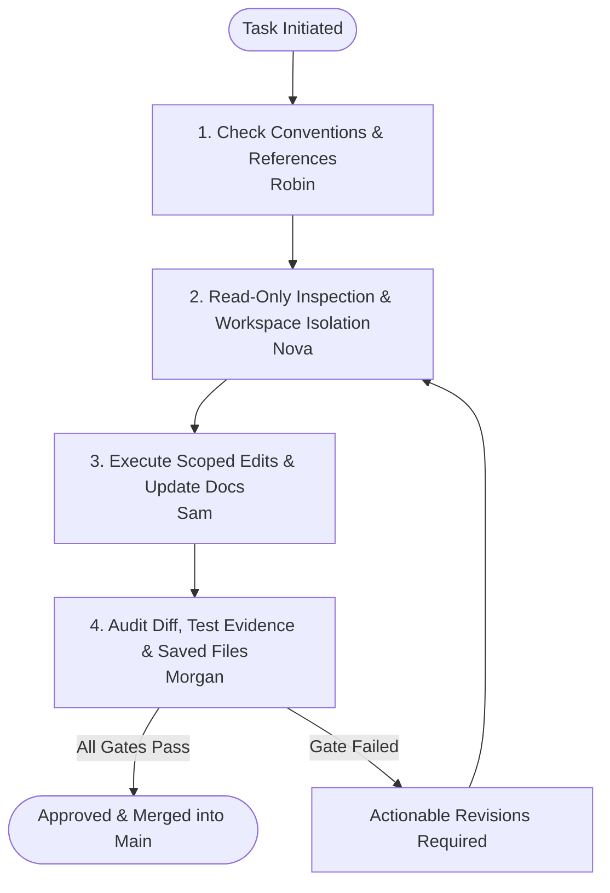
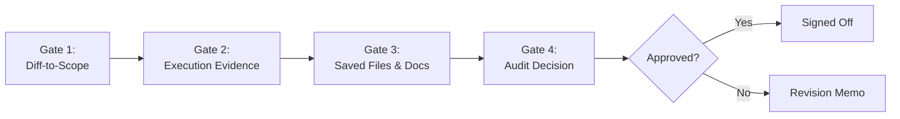

# Star Office World — Self-Service Project Editing Playbook & Quality Standards

*Originated from Team Meeting: "help your self edit the projects"*  
*Lead Coordinator: Alex | Principal Engineer: Nova | Senior Researcher: Robin | Technical Writer: Sam | QA & Auditor: Morgan*

---

## Executive Overview & Core Principle

In Star Office World, self-service project editing empowers agents and contributors to make rapid, iterative enhancements to repositories without creating bottlenecks. However, **speed must never compromise platform integrity, runtime stability, or code quality.**

To achieve this balance, self-service edits strictly follow the **Four-Pillar Governance Flow**:
1. **Upfront Conventions & Reference Checks** (*Robin / Senior Researcher*)
2. **Isolated Workspaces & Pre-Merge Diff Review** (*Nova / Principal Engineer*)
3. **Standardized Task Templates & Doc-Change Checklists** (*Sam / Technical Writer*)
4. **Mandatory QA Verification Gates & Audit Memos** (*Morgan / QA & Auditor*)



---

## 1. Upfront Repository Conventions & Reference Checks (*Robin*)

Before touching any code or configuration, inspect authoritative repository sources and established patterns:

### 1.1 In-Repo Authority Sources
* **Project Documentation:** `README.md`, `CONTRIBUTING.md`, `ARCHITECTURE.md`, and module specs.
* **Agent & Tooling Instructions:** `AGENTS.md`, `.cursorrules`, and workspace configuration files.
* **Linters & Toolchain Rules:** `tsconfig.json`, `eslint.config.*`, `.prettierrc*`, and build scripts.
* **CI/CD Definitions:** `.github/workflows/*` to know the exact automated checks that must pass.
* **Existing Test Patterns:** Unit and integration test suites in `test/` to mirror assertion styles and fixtures.

### 1.2 Architecture & Dependency Hygiene
* **Respect Layer Boundaries:** Domain logic, state management, I/O adapters, and UI/SSE routes must remain decoupled. Never leak transport or raw SDK objects into core domain models.
* **Protect Public Contracts:** Check exports (`index.ts`, public interfaces, REST API endpoints, SSE event unions) to prevent breaking public consumers.
* **Dependency Discipline:** Use existing internal utilities or installed packages. Never add external dependencies without explicit architecture approval.
* **Structured Error & Telemetry Standards:** Use existing logging, SSE event dispatch, and error classes.

---

## 2. Technical Workflow: Isolation & Diff Review (*Nova*)

Every non-trivial code modification must be executed safely through the Antigravity integration or isolated workspace branches:

### Phase 2.1: Read-Only Repository Inspection
1. **Inspect Workspace & Git Baseline:**
   - Execute `inspect_antigravity_workspace(workspaceId="default_workspace")` to confirm workspace existence, path, and lock state.
   - Execute `get_antigravity_workspace_git_status(workspaceId="default_workspace")` to verify branch, `HEAD` commit, and a clean working tree.
2. **Scan Directory & Architecture:**
   - Use `list_antigravity_workspace_files` and `read_antigravity_workspace_file` to inspect relevant modules and test suites without modifying repository files.
   - Keep local scratch files (`workspace_*` tools) strictly separated from production repository code.

### Phase 2.2: Scoped Delegation & Execution Isolation
1. **Check Active Tasks & Bridge Readiness:**
   - Verify `check_antigravity_bridge` reports `CONNECTED`.
   - Check `list_antigravity_tasks` to ensure no conflicting task holds an active lock. Cancel or resolve interrupted tasks if present.
2. **Scoped Execution:**
   - Target dedicated feature branches or isolated workspaces.
   - Define explicit boundaries: title, objective, exact file targets, and concrete test criteria.

### Phase 2.3: Pre-Merge Diff & Output Review
1. **Telemetry & Artifact Audit:**
   - Call `get_antigravity_task_details(taskId=...)` to review agent output, file changes, and test results.
2. **Working Tree Verification:**
   - Call `get_antigravity_workspace_git_status` to ensure uncommitted diffs match the scoped files with 0 extraneous changes.
   - Verify all tests pass (`npm run build && npm test`).
3. **Merge & State Update:**
   - Merge verified changes, confirm clean git status, and notify stakeholders.

---

## 3. Self-Service Editing Playbook & Task Template (*Sam*)

### 3.1 When to Self-Edit vs. When to Coordinate
* **Proceed with Self-Service:**
  - Changes are localized to known files, documentation, or targeted features within your scope.
  - Public contracts and API behavior remain backward-compatible.
  - Tests are deterministic, fast, and verify the exact change.
* **Escalate / Call Team Meeting:**
  - Changes cross major architectural boundaries, shared state schemas, or core storage models.
  - Modifying permissions, security barriers, or deployment credentials.
  - Ambiguity regarding product direction or requirements.

### 3.2 Standardized Task Template
Copy and populate this template when creating or executing self-service tasks:

```markdown
### Task: <Concise Imperative Title>
- **Task ID:** <task_id> | **Date:** <YYYY-MM-DD>
- **Assignee / Role:** <Agent Name / Role>
- **Workspace:** <workspaceId> | **Origin:** <Meeting / Issue / Request>

#### 1. Scope & Objectives
- **Goal:** <One-sentence clear outcome statement>
- **In Scope:**
  - `<file/module 1>` — <planned change>
  - `<file/module 2>` — <planned change>
- **Out of Scope (Explicit Non-Goals):**
  - <Items explicitly avoided or deferred>

#### 2. Upfront References & Citations
- **Local Sources:** `<path/to/source>` (rules, existing conventions checked)
- **External Specs:** `<url or doc standard>` (APIs or specs verified)

#### 3. Planned Changes & Documentation
- [ ] Code modifications applied within scoped files
- [ ] Accompanying documentation / README / types updated
- [ ] No stale instructions, unresolved TODOs, or broken imports

#### 4. Verification & Evidence
- **Commands Run:** `<build / test command>`
- **Observed Result:** <Pass/fail summary and metrics>
- **Definition of Done:** <Criteria proving task completeness>
```

### 3.3 Documentation-Change Checklist
- [ ] **Grounding & Accuracy:** Every path, flag, parameter, and command matches actual implementation.
- [ ] **Clarity & Structure:** Scannable headings, concise tables, and clear code examples.
- [ ] **Scope Alignment:** Accompanying doc updates match the diff without touching unrelated docs.
- [ ] **Cross-References:** All markdown file links, schemas, and identifiers remain valid.

---

## 4. Mandatory QA Verification Gates & Audit Memo Standard (*Morgan*)

No self-service project edit may be marked complete or merged without passing all four mandatory quality gates:



### Gate 1: Diff-to-Scope Inspection
* Verify that every changed file directly supports the task's stated objectives.
* Zero stray files, unrequested refactors, leftover debugging code, or altered configuration outside the scope.

### Gate 2: Real Execution & Test Evidence
* Code modifications must be backed by executed commands and real output logs.
* Build step (`npm run build`) must exit with code 0.
* Targeted and regression test suites (`npm test`) must pass with 0 failures.
* Natural-language claims of "tested" without execution provenance are strictly rejected.

### Gate 3: Saved Files & Documentation Review
* Persisted files must be confirmed present on disk and non-empty.
* Syntax, formatting, and type-checks must be verified.
* Accompanying documentation, interfaces, and READMEs must reflect new behavior without discrepancies.

### Gate 4: Approval or Revision Decision
* **APPROVED:** All gates passed with verifiable evidence. Deliverable is signed off.
* **REVISION REQUIRED:** Any gate failure generates an actionable revision memo specifying the defect, location, and required fix.

### 4.1 QA Audit Memo Template

```markdown
# QA Audit Memo: <Task Title> (<Task ID>)
- **Status:** APPROVED | REVISION REQUIRED
- **Auditor:** Morgan (QA & Auditor)
- **Target Workspaces / Files:** <file paths>

## 1. Scope & Execution Evidence
- Build Status: PASS (code 0)
- Tests Executed: <count> passed, 0 failed
- Provenance Verified: <tool executions listed>

## 2. Gate Evaluation
- **Gate 1 (Diff-to-Scope):** PASS / FAIL — <note>
- **Gate 2 (Real Execution):** PASS / FAIL — <note>
- **Gate 3 (Saved Files & Docs):** PASS / FAIL — <note>

## 3. Disposition
<Clear statement approving merge or listing required remediation items>
```

---

## Summary of Action Item Realization

| Action Item | Owner | Artifact / Specification | Status |
| :--- | :--- | :--- | :--- |
| **1. Antigravity Workflow** | Nova | Section 2: 3-Phase Read-Only, Isolation & Diff Review | ✅ Verified |
| **2. Project Conventions** | Robin | Section 1: In-Repo Sources & Boundary Rules | ✅ Verified |
| **3. Playbook & Templates** | Sam | Section 3: Self-Service Playbook, Template & Doc Checklist | ✅ Verified |
| **4. QA Gates & Audit Memo**| Morgan| Section 4: 4 Mandatory Gates & Audit Memo Standard | ✅ Verified |
